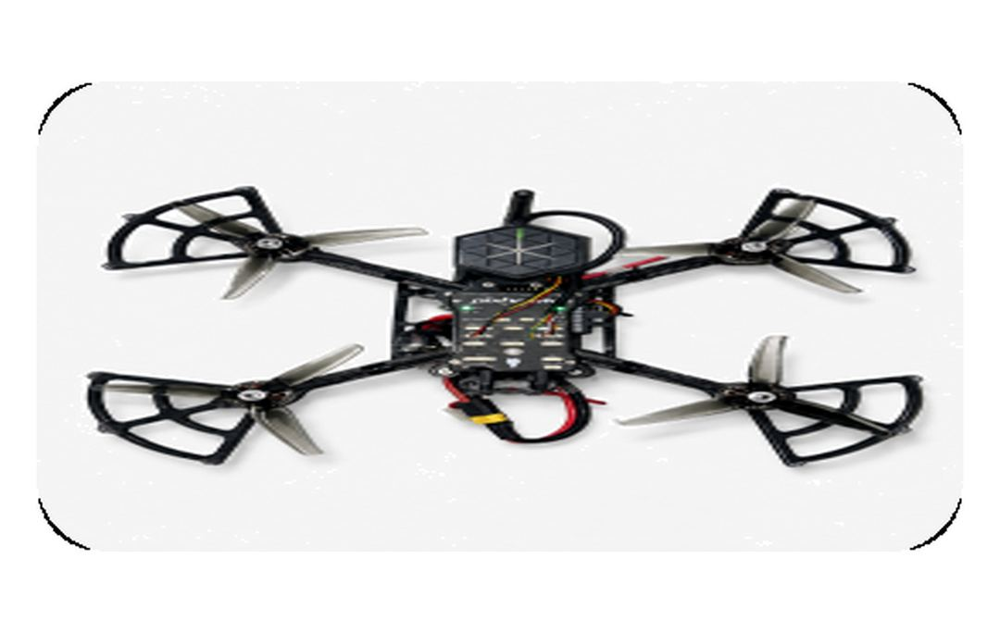
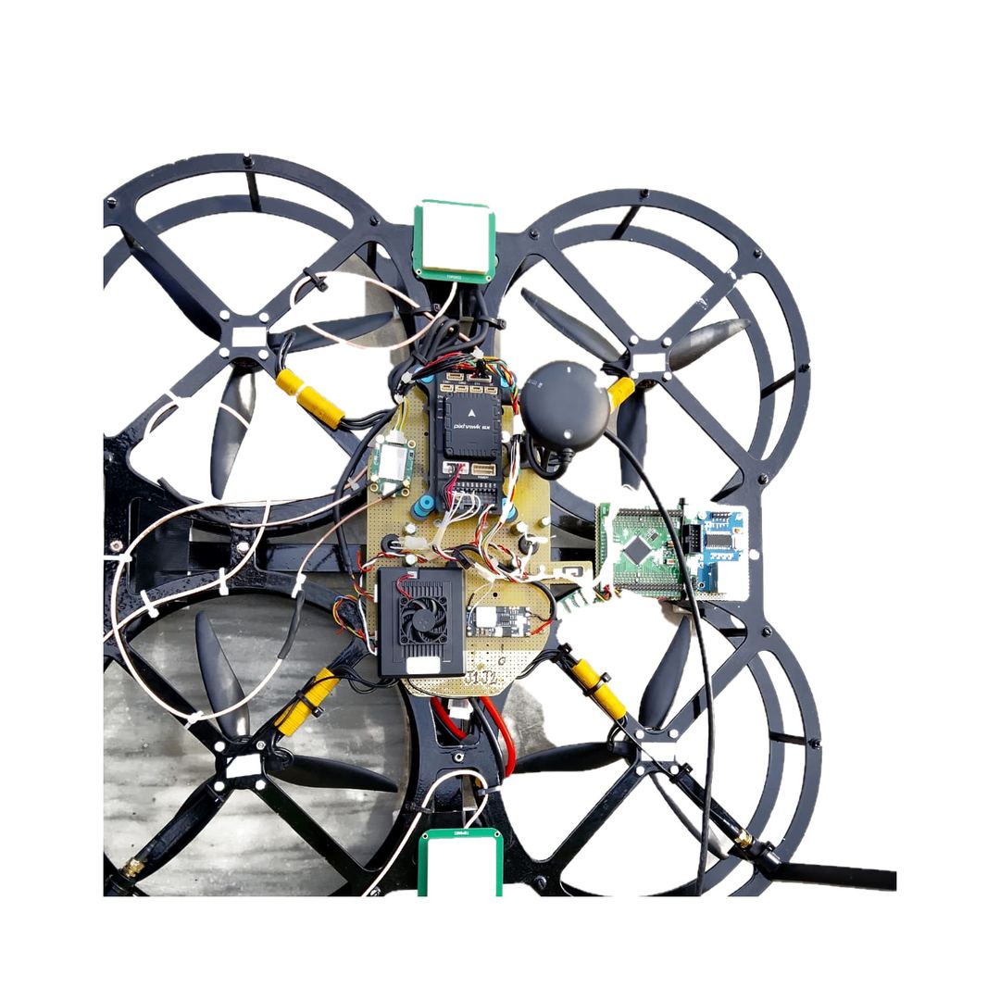
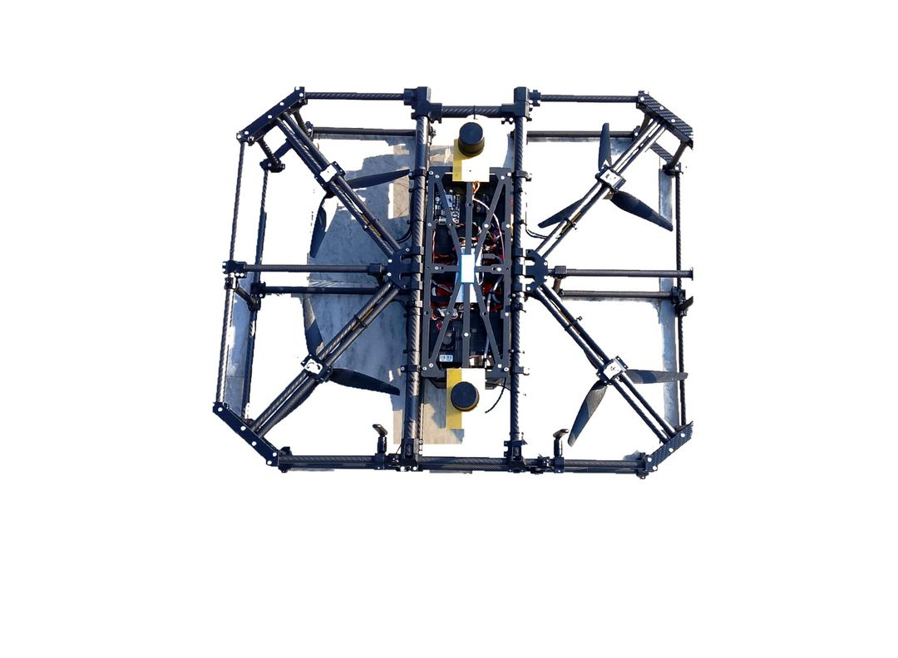

# Autonomous UAV System

This repository covers my work on quadcopter development and flight testing. I started with a small drone using Pixhawk 2.4.8, then moved to a mid-size platform with an STM32H7-based Pixhawk controller. The current stage is a larger 736 × 615 mm quadcopter, where I am working more deeply on PX4 flight control, sensor integration and flight-data analysis.

The work includes hardware assembly, motor and ESC setup, PX4 and QGroundControl configuration, GNSS/EKF2, PID and gyro-filter tuning, power monitoring and RF video/telemetry. I am keeping the testing results together with the problems I found and the changes that still need validation.

## Drone development

| First prototype | Mid-size platform | Current large quadcopter |
| :---: | :---: | :---: |
|  |  |  |
| [Pixhawk 2.4.8](vehicles/01-small-drone/README.md) | [STM32H7-based Pixhawk](vehicles/02-mid-size-drone/README.md) | [736 × 615 mm test platform](vehicles/03-large-drone/README.md) |

The first drone helped me understand motor direction, actuator mapping, calibration and basic flight behaviour. The later platforms gave me more room to work on sensor integration, control performance and testing over longer distances. The controller upgrade provides more processing capability, while actual flight range also depends on the communication system, antennas, battery and aircraft setup.

## Flight control and tuning

I spent a lot of time understanding the PX4 cascaded control structure before changing parameters. I worked with the attitude and angular-rate loops, compared requested and measured body rates, and studied how gyro filtering, motor vibration and ESC feedback affect control.

I compared recorded controller settings from three tests on the larger PX4 platform. The roll and pitch rate gain multipliers increased from 1.0 to 1.1 and later to 1.4. The later configuration also used different D gains, attitude gains and gyro filters. These are recorded changes, not proof that every adjustment improved the response. The tests were not all performed in the same flight mode.

The main findings from the flight data were:

- **Gyro vibration:** A strong vibration band appeared near 130–150 Hz, close to reported motor shaft frequencies. This led me to investigate mechanical vibration and notch filtering instead of choosing an arbitrary filter frequency.
- **ESC RPM feedback:** Two channels produced missing or implausible RPM values while the motors were commanded to run. I am checking telemetry reliability before using RPM feedback to judge dynamic filtering.
- **Power and temperature:** A later flight lasted about five minutes airborne and reported around 6.64 Ah consumed, noticeable voltage sag and one ESC temperature channel reaching about 92°C. The electrical calibration and temperature reading still need independent checks.
- **State estimation:** I investigated the GNSS antenna lever arm and the effect of battery placement on the centre of gravity. I am checking the measured mounting offsets against the saved EKF2 settings.
- **RF video and telemetry:** I am investigating intermittent video interruptions on a link shared with MAVLink telemetry.

These results come from onboard flight measurements. I have kept the limitations and open checks in the technical pages rather than presenting an unverified performance claim.

[PX4 control architecture](docs/px4-control-system.md) · [Controller and filter settings](docs/px4-tuning-history.md) · [Vibration and ESC feedback](docs/px4-gyro-filter-investigation.md) · [Testing method](docs/tuning-and-logs.md)

## Flight tests and media

The [flight-test records](docs/flight-records/README.md) describe the purpose, flight mode, measurements and findings of each test in a way that can be understood without opening a raw log. The raw PX4 recordings are kept private because they may contain position and system information.

I have added overview photos of the three drones. I will add the matching flight videos, confirmed test distances and further hardware photos as I organize them. No flight range is claimed here without a verified record.

[Photos](media/photos/README.md) · [Flight videos](media/videos/README.md) · [Test records](docs/flight-records/README.md)

## Technical documentation

| Area | Documentation |
| --- | --- |
| Hardware and setup | [Hardware](docs/hardware.md), [PX4 calibration](docs/setup-and-calibration.md), [GNSS/EKF2](docs/gnss-and-ekf2.md) |
| Control and analysis | [Controller architecture](docs/px4-control-system.md), [Tuning history](docs/px4-tuning-history.md), [Filtering investigation](docs/px4-gyro-filter-investigation.md) |
| Flight systems | [Battery](docs/battery-and-power.md), [ESC temperature](docs/esc-temperature.md), [RF video and telemetry](docs/video-and-telemetry.md) |
| Testing | [Flight records](docs/flight-records/README.md), [Preflight checks](docs/preflight-checklist.md), [Next work](docs/next-work.md) |

## Repository structure

```text
vehicles/        Separate hardware and development stages
docs/            Control, integration, tuning and test findings
configs/         Selected historical PX4 parameter snapshots
media/photos/    Drone hardware photographs
media/videos/    Planned flight video records and links
logs/            Raw-data handling and privacy notes
scripts/         Tools for checking PX4 flight data
assets/plots/    Verified analysis plots as they are prepared
```

This is an ongoing engineering project. I am keeping measured results separate from assumptions and will update the documentation when further tests confirm the changes.
