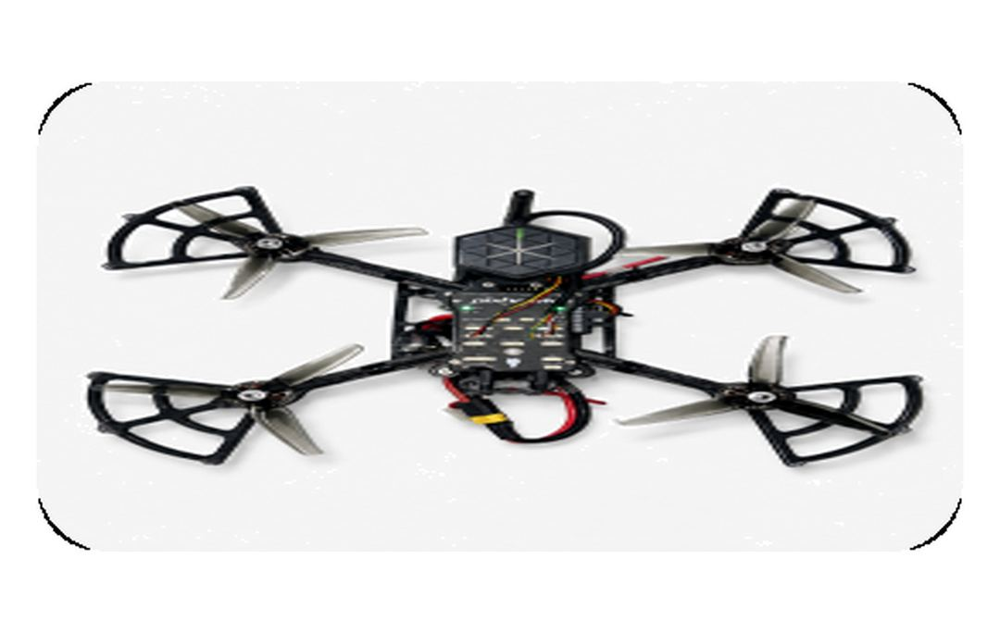

# 01 - Small Quadcopter

This was the first stage of my drone work. I used a Pixhawk 2.4.8 flight controller on this initial drone and started with a smaller quadcopter to understand the basic hardware, PX4 configuration and flight testing before moving to larger frames.

The initial work included frame configuration, motor order and direction, propeller direction, sensor and RC calibration and basic takeoff tests. I also checked the centre of gravity and uneven lift when the drone did not take off as expected.

Some early notes mention a 6-inch Mark 4 frame and Emax 2306 1800KV motors. I will confirm whether these belong to this exact build before listing them as final specifications. I do not want to mix the parts from different drones.

## Photos

I will upload these files to [the photo folder](../../media/photos/README.md):

- `small-drone-overview.jpg`: full assembled drone
- `small-drone-assembly.jpg`: frame, motors and wiring
- `small-drone-pixhawk.jpg`: flight controller mounting, if available

## Flight videos

- `small-drone-flight-01.mp4`: first video I will add
- `small-drone-flight-02.mp4`: another flight, if available

The overview photo is added. I will add the original videos and flight details when I upload them. No flight distance or duration has been assumed here.

## Hardware and tests

| Item | Details |
| --- | --- |
| Frame | Small quadcopter, exact model to confirm |
| Flight controller | Pixhawk 2.4.8 (confirmed from project build information) |
| Motors / ESCs | To confirm from actual hardware |
| Battery | To add |
| Propellers | To add |
| Flight status | Initial flight testing was performed |

I will add the hardware photo, final parts list and configuration for this drone separately.