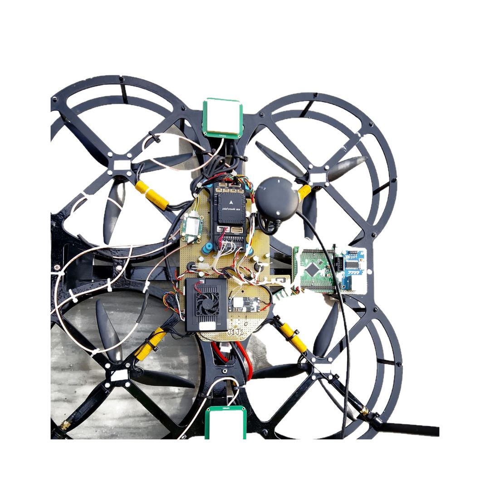

# 02 - Mid-Size Quadcopter

After the small drone, I worked on another quadcopter with a bigger frame. In the next stage I moved from Pixhawk 2.4.8 to a more advanced Pixhawk variant based on an STM32H7 microcontroller. I made this change as part of developing the flight control and communication setup for longer-range testing. A faster controller gives more processing headroom, but the actual flight range also depends on the radio link, battery, antennas and the complete aircraft.

I want to keep its hardware, setup and flight results separate so it is easy to see how the design changed from the first drone.

## Photos to add

- `mid-size-drone-overview.jpg`: full assembled drone
- `mid-size-drone-assembly.jpg`: frame and component placement
- `mid-size-drone-pixhawk.jpg`: flight controller and wiring, if available

## Flight videos to add

- `mid-size-drone-flight-01.mp4`
- `mid-size-drone-flight-02.mp4`

I will add the flight distances, dates and the test result after matching each video with the correct flight.

## Hardware

| Item | Details |
| --- | --- |
| Frame size | Mid-size, measured dimensions to add |
| Flight controller | STM32H7-based Pixhawk variant, exact model to confirm |
| Motors and ESCs | To confirm |
| Propellers | To confirm |
| Battery | To confirm |
| Video / telemetry | To confirm |

I will update this page from the real photos and hardware instead of guessing the parts.