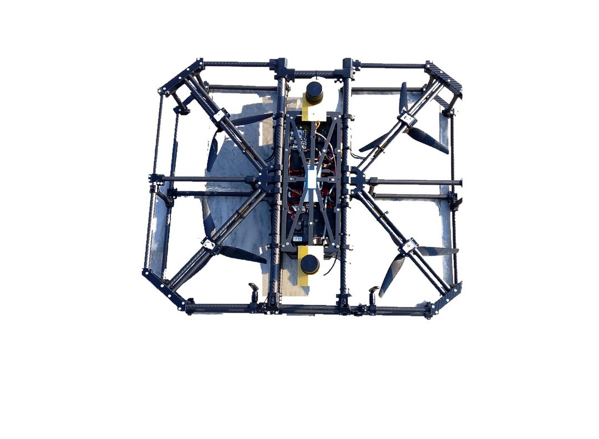

# 03 - Large Quadcopter (736 mm × 615 mm)

This is the current and largest drone in my project. The approximate overall frame dimensions are 736 mm × 615 mm.

My recent work has been around PX4 setup, GNSS and EKF2, motor and ESC feedback, battery monitoring, flight logs and a sight/camera system that uses a shared RF link for live video and telemetry.

## Photos to add

- `large-drone-overview.jpg`: assembled drone, full view
- `large-drone-top-view.jpg`: top view showing the frame and component placement
- `large-drone-side-view.jpg`: side view, including battery mounting
- `large-drone-pixhawk.jpg`: flight controller mounting
- `large-drone-gnss.jpg`: GNSS antenna mounting
- `large-drone-sight-rf.jpg`: sight and RF hardware, if suitable to share

I will upload these under [media/photos](../../media/photos/README.md).

## What I have been working on

I used PX4 and QGroundControl for the airframe and sensor configuration. During setup I investigated the GNSS antenna offset from the flight controller and why an antenna away from the centre of gravity sees additional translational movement when the drone rotates.

I also checked the PID and IMU filtering, motor/ESC behaviour and the battery monitoring parameters using PX4 flight logs. One recent flight log reported an ESC temperature that was higher than the others. I am also checking intermittent video loss when video and telemetry are transmitted over the same RF link.

## PX4 control and tuning work

I did not stop after getting the drone into the air. I studied the rate and attitude loops, PID gain changes, gyro filtering, vibration frequency and motor RPM feedback using the actual ULogs. The saved parameters show that the controller configuration changed across the flights, including the overall rate gains, D terms, attitude gains, gyro cutoffs and dynamic notch settings.

The 4 November logs showed strong gyro vibration near 130–150 Hz and unreliable RPM reports on ESC 2 and 3. The 14 November log contains a later set of gains and filters, but I still need a controlled test to show which changes actually helped. I am keeping both the progress and the unresolved issues in the documentation.

[PX4 controller explanation](../../docs/px4-control-system.md) · [Real parameter history](../../docs/px4-tuning-history.md) · [Vibration and RPM investigation](../../docs/px4-gyro-filter-investigation.md)

## Hardware known from the recent PX4 log

| Item | Information |
| --- | --- |
| Airframe | Large quadcopter, about 736 × 615 mm |
| Flight controller family | `PX4_FMU_V6X`, subtype `V6X008` in recent ULog |
| Battery | Tattu 6S LiPo, 12000 mAh label |
| ESCs | Four ESC channels recorded; exact model to add |
| Motors / propellers | Exact models to confirm |
| RF and sight | Video and MAVLink telemetry on one RF link; model to add |
| Power module | Model and current calibration to confirm |

The flight controller identity is taken from the log, not from a photograph of the board. I still need to check the exact manufacturer/model.

## Flight videos to add

- `large-drone-flight-01.mp4`: regular flight
- `large-drone-flight-02.mp4`: another flight
- `large-drone-range-test-01.mp4`: range test, if recorded
- `12_43_50-flight.mp4`: video linked to the log only if the timestamps match

The videos are not uploaded yet. I will add the actual tested ranges rather than writing estimated numbers.

[Flight record from ULog 12_43_50](../../docs/flight-records/12_43_50.md) · [Battery notes](../../docs/battery-and-power.md) · [ESC temperature](../../docs/esc-temperature.md) · [Video and telemetry](../../docs/video-and-telemetry.md)